

  <picture>
    <source media="(prefers-color-scheme: dark)" srcset="docs/images/lockup-dark.svg">
    
  </picture>

<h1 align="center">TinkerPad</h1>

<b>ESP32-S3 Blueprints No.02</b> · a Lonely Binary series (<a href="#about-esp32-s3-blueprints">about</a>)

  An ESP32-S3 board with 16 lit keys, a microphone and a speaker. 
  One board, many projects: games, music, a voice message board, a USB keyboard.

> [!CAUTION]
> **Check the ESP32-S3 board before you power it on. Plugged in wrong, it can burn.**
>
> - **Direction:** the two USB-C ports on the ESP32-S3 board must face the **left edge** of
>   TinkerPad, as printed on the back: *"ALIGN USB TO THE LEFT SIDE"*.
> - **Alignment:** every pin must go into its own socket hole. Make sure the board is not
>   shifted by one pin, and that no pin is left hanging outside the socket.
> - Only plug in USB or the battery **after** you have checked both.

  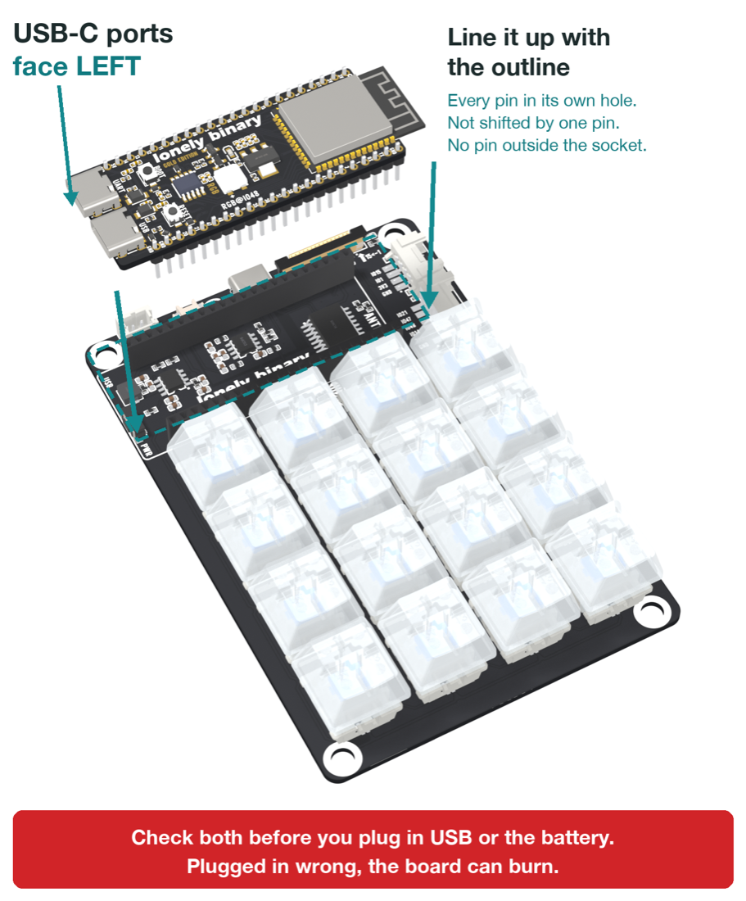

## Examples

**No Arduino IDE?** Install ready-made programs from Chrome or Edge with the
[TinkerPad Web Installer](https://lonely-binary.github.io/TinkerPad/): plug in the board,
click Install, pick the port.

To build them yourself, open any folder in the Arduino IDE and upload it. Each one is independent.

### Start here

<table>
<tr><td width="400"><a href="examples/01_HardwareTest">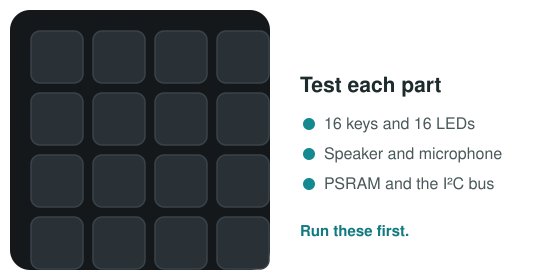</a></td><td><h3>Hardware tests</h3>Eight small sketches, one per part: the keys, the 16 LEDs, the speaker, the microphone, recording and playing back, the PSRAM and the I²C bus. Run them first when you get a board, so you know every part works before you build anything bigger.  <a href="examples/01_HardwareTest">Code &amp; guide</a></td></tr>
</table>

### Games

<table>
<tr><td width="400"><a href="examples/02_Games/MemoryLights">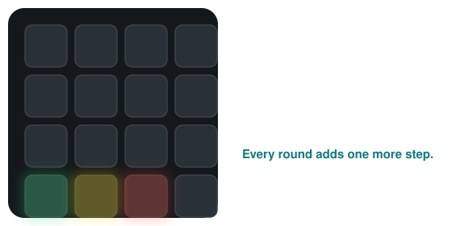</a></td><td><h3>MemoryLights</h3>The classic memory game. The pads light up one after another, each with its own colour and xylophone note, and you play them back in the same order. Every round adds a step and goes a little faster. Three levels: 4, 8 or all 16 pads.  <a href="https://lonely-binary.github.io/TinkerPad/#memorylights"><b>▶ Install firmware</b></a> · <a href="examples/02_Games/MemoryLights">Code &amp; guide</a></td></tr>
<tr><td width="400"><a href="examples/02_Games/WhackAMole"></a></td><td><h3>WhackAMole</h3>Moles pop up all over the board; hit them before they hide. Golden moles are worth three points, red flashing bombs cost five. A round lasts 30 seconds and the moles speed up every 10.  <a href="https://lonely-binary.github.io/TinkerPad/#whackamole"><b>▶ Install firmware</b></a> · <a href="examples/02_Games/WhackAMole">Code &amp; guide</a></td></tr>
<tr><td width="400"><a href="examples/02_Games/PingPong">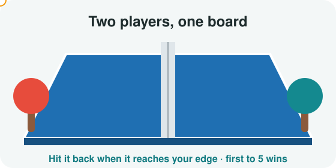</a></td><td><h3>PingPong</h3>Table tennis for two, with the board between you. Each player's bat is the column of keys on their edge. Hit the ball back when it reaches you; it speeds up and can switch rows. First to 5 wins.  <a href="https://lonely-binary.github.io/TinkerPad/#pingpong"><b>▶ Install firmware</b></a> · <a href="examples/02_Games/PingPong">Code &amp; guide</a></td></tr>
<tr><td width="400"><a href="examples/02_Games/SoundMatch"></a></td><td><h3>SoundMatch</h3>A memory game you play with your ears. Sixteen keys hide eight pairs of real sounds: animals, a doorbell, coins. Turn two over at a time and find all the pairs in as few tries as you can.  <a href="https://lonely-binary.github.io/TinkerPad/#soundmatch"><b>▶ Install firmware</b></a> · <a href="examples/02_Games/SoundMatch">Code &amp; guide</a></td></tr>
<tr><td width="400"><a href="examples/02_Games/BeatGrid">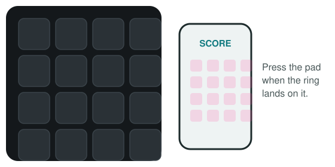</a></td><td><h3>BeatGrid</h3>A rhythm game. The board makes its own Wi-Fi, and your phone or computer shows rings closing in on the pads; press each one as its ring lands. The board plays the music and keeps the score.  <a href="https://lonely-binary.github.io/TinkerPad/#beatgrid"><b>▶ Install firmware</b></a> · <a href="examples/02_Games/BeatGrid">Code &amp; guide</a></td></tr>
</table>

### Music

<table>
<tr><td width="400"><a href="examples/03_Music/MidiPad">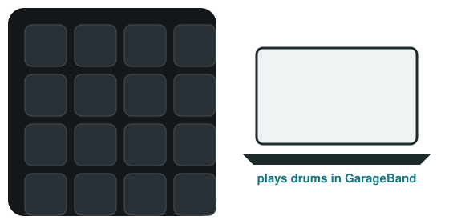</a></td><td><h3>MidiPad</h3>Plugged into a computer it is a USB MIDI drum pad for GarageBand, Logic or Ableton. On its own it is a music game: pick one of 12 songs and follow the lights to play the melody while the drums play along.  <a href="https://lonely-binary.github.io/TinkerPad/#midipad"><b>▶ Install firmware</b></a> · <a href="examples/03_Music/MidiPad">Code &amp; guide</a></td></tr>
<tr><td width="400"><a href="examples/03_Music/UkuleleTeacher"></a></td><td><h3>UkuleleTeacher</h3>The keys become a ukulele fretboard, one row per string. The teacher plays a phrase, then the lights show you where to press, one note at a time, until you can play the whole song. What you learn is where your fingers go on a real ukulele.  <a href="https://lonely-binary.github.io/TinkerPad/#ukuleleteacher"><b>▶ Install firmware</b></a> · <a href="examples/03_Music/UkuleleTeacher">Code &amp; guide</a></td></tr>
</table>

### Apps

<table>
<tr><td width="400"><a href="examples/04_Apps/VoiceBoard">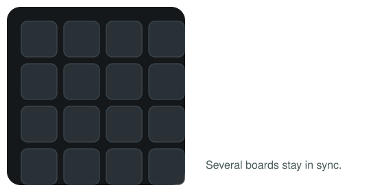</a></td><td><h3>VoiceBoard</h3>A voice message board for a family of up to twelve, one key each. Tap MIC, tap a person and talk; their key glows until they listen. Several boards around the house keep each other in sync, over ESP-NOW or your Wi-Fi.  <a href="https://lonely-binary.github.io/TinkerPad/#voiceboard"><b>▶ Install firmware</b></a> · <a href="examples/04_Apps/VoiceBoard">Code &amp; guide</a></td></tr>
<tr><td width="400"><a href="examples/04_Apps/MacroPad"></a></td><td><h3>MacroPad</h3>A Bluetooth shortcut keyboard. Give each key any shortcut from a web page on your phone or computer, pair it with your Mac or PC, and copy, paste or screenshot with one press.  <a href="https://lonely-binary.github.io/TinkerPad/#macropad"><b>▶ Install firmware</b></a> · <a href="examples/04_Apps/MacroPad">Code &amp; guide</a></td></tr>
<tr><td width="400"></td><td><h3>ComboPad</h3>A combo keyboard for fighting games such as King of Fighters and Street Fighter. Each key plays a whole combo as a USB keyboard, frame by frame. Choose the combos from a web page. For offline and training play.  <a href="https://lonely-binary.github.io/TinkerPad/#combopad"><b>▶ Install firmware</b></a> · <a href="examples/04_Apps/ComboPad">Code &amp; guide</a></td></tr>
</table>

Most games, MidiPad, UkuleleTeacher and ComboPad need **USB Mode: USB-OTG (TinyUSB)** in the
Arduino IDE. Each example's README lists its exact settings.

## What is on the board

- **ESP32-S3 N16R8**: 16 MB flash, 8 MB PSRAM, Wi-Fi and Bluetooth LE
- **16 mechanical keys**, each with its own **RGB LED** under it
- **Microphone** (PDM) and **speaker output** (I²S amplifier)
- **Battery connector** with a charger, and a power USB-C that charges it
- **Two expansion ports** and a **display connector**
- **Two USB-C ports** on the ESP32-S3 board for uploading: UART and native USB

  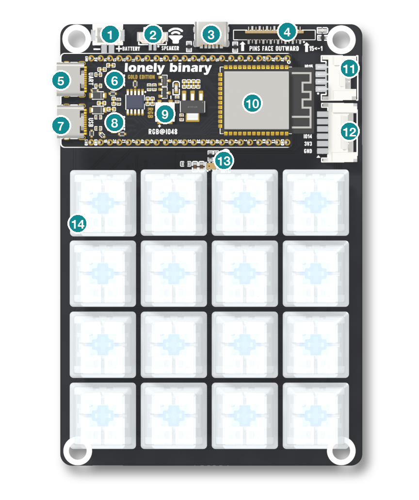

| # | Part | Details |
|---|---|---|
| 1 | Battery | PH2.0 connector, 1-cell Li-ion |
| 2 | Speaker | 1.25 mm connector, I²S amplifier |
| 3 | USB-C (power) | 5 V in, charges the battery. No data |
| 4 | Display connector | FPC 15-pin, 1.0 mm |
| 5 | USB-C (UART) | Upload and serial monitor |
| 6 | BOOT button | Hold it while plugging in if an upload will not start |
| 7 | USB-C (native USB) | Upload, serial, or act as a USB keyboard / MIDI device |
| 8 | RESET button | Restarts the program |
| 9 | Status RGB LED | One WS2812 on IO48 |
| 10 | ESP32-S3 module | |
| 11 | Port A | GND · 3V3 · IO1 · IO15 |
| 12 | Port B | GND · 3V3 · IO14 · IO48 · IO47 · IO21 |
| 13 | Microphone | PDM |
| 14 | Keys and LEDs | 16 keys, 16 WS2812B LEDs |

## Pins

| Part | Pins |
|---|---|
| Keys (PCF8574, I²C address `0x20`) | SDA **9**, SCL **8** |
| Key LEDs (16 × WS2812B) | **38** |
| Speaker (I²S) | DIN **18**, BCLK **17**, LRCLK **16** |
| Microphone (PDM) | DATA **39**, CLK **40** |
| Status LED (WS2812) | **48** |
| Battery voltage | **3**, through a 100k/100k divider. Short the solder pads on the back to connect it |
| Battery charger (IP5306, I²C `0x75`) | shares SDA 9 / SCL 8 |
| Display (FPC 15-pin) | BL 41, RESET 42, DC 2, CS 10, MOSI 11, MISO 13, SCK 12, D2 1, D3 15, D4 7, D5 4, D6 6, D7 5 |

Some pins are shared. Port A uses IO1 and IO15, which are also display D2 and D3.
Port B's IO48 is also the status LED.

**Key numbering.** Keys, key LEDs and positions all use the same number: 0 is the
top-left key, 3 the top-right, 15 the bottom-right. The LED under key *n* is LED *n*.

## Getting started

1. Install the **Arduino IDE 2.x** and **esp32 by Espressif Systems** from the Boards Manager.
   Step-by-step instructions are in
   [`examples/01_HardwareTest/README.md`](examples/01_HardwareTest/README.md).
2. Plug a USB cable into **one** of the two USB-C ports on the ESP32-S3 board (5 or 7 above).
3. In the **Tools** menu:

   | Setting | Value |
   |---|---|
   | Board | ESP32S3 Dev Module |
   | Flash Size | 16MB (128Mb) |
   | PSRAM | OPI PSRAM |
   | Partition Scheme | 16M Flash (3MB APP/9.9MB FATFS) |
   | USB CDC On Boot | **Disabled** on the UART port, **Enabled** on the USB port |

4. Install **FastLED** from the Library Manager. Most examples use it for the LEDs.
5. Open `examples/01_HardwareTest/KeyMatrix`, upload, open the Serial Monitor at
   115200 baud and press some keys.

If the Serial Monitor stays empty, the **USB CDC On Boot** setting does not match the
port you plugged into.

## Not tested yet

The battery voltage reading, the IP5306 charger status and the display connector are on
the board but do not have working examples yet.

## About ESP32-S3 Blueprints

**ESP32-S3 Blueprints** is a Lonely Binary series: finished things you'd actually want on your
desk, each shipped with the complete blueprint behind it. Every entry is built on the
ESP32-S3, so what you learn on one carries over to the next, and comes with the full source.

| No. | Blueprint | Status |
|---|---|---|
| 01 | **[Word Clock](https://github.com/Lonely-Binary/WordClock)**: an 11×10 word panel with six faces | ✅ Available |
| **02** | **TinkerPad**: 16 lit keys, a microphone and a speaker | ✅ This repo |

## License

[MIT](LICENSE) © 2026 Lonely Binary

---

<i>From Zeros to Heroes, One Bit at a Time.</i>

