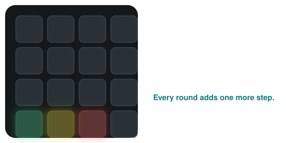

# MemoryLights

<a href="https://lonely-binary.github.io/TinkerPad/#memorylights"><b>▶ Install from your browser</b></a> · no Arduino IDE needed

Watch the lights, then play them back: the classic memory game. Every pad has its own
colour and its own xylophone note, low notes at the bottom and high notes at the top, so you
remember the tune as well as the lights.

## How to play

1. **Choose a level** on the bottom row:
   - green: easy, the 4 middle pads
   - yellow: normal, the 8 pads of the middle two rows
   - red: hard, all 16 pads
2. **Watch.** Some pads light up one after another, each with its own note.
3. **Repeat them** in the same order.
4. Every round adds one more step and plays a little faster.

A wrong pad, or waiting longer than 6 seconds, ends the game; the pad you should have pressed
blinks.

**Score:** the number of rounds you completed. The pads fill up one per round: first 16 green,
then blue, purple and gold. A new high score (kept for each level) plays a fanfare and a
rainbow. Press any key to go back to the level choice.

## Install

**From the browser (no Arduino IDE):** open the [TinkerPad Web Installer](https://lonely-binary.github.io/TinkerPad/) in Chrome or
Edge, plug in the board, click **Install** next to this program and pick the port.

**From the Arduino IDE:** open the `.ino` file in this folder, choose these settings in the
**Tools** menu, and upload. Library needed: **FastLED**.

| Setting | Value |
|---|---|
| Board | ESP32S3 Dev Module |
| Flash Size | 16MB (128Mb) |
| PSRAM | OPI PSRAM |
| Partition Scheme | 16M Flash (3MB APP/9.9MB FATFS) |
| **USB Mode** | **USB-OTG (TinyUSB)** |
| USB CDC On Boot | Enabled |
| **Upload Mode** | **USB-OTG CDC (TinyUSB)** |

This sketch takes over the port marked **USB**. If an upload fails, hold **BOOT**, tap
**RESET**, let go of BOOT and upload again, or upload through the **UART** port.

## Sounds

Effects by Kenney (www.kenney.nl) and a xylophone from FreePats / Versilian Community Sample
Library, all CC0. `tools/make_sounds.py` rebuilds `sounds.h`; `tools/preview.wav` lets you hear
them on a computer.

## Files

| File | What it is |
|---|---|
| `MemoryLights.ino` | The game |
| `sounds.h` | The sounds, as sample data (generated) |
| `tools/make_sounds.py` | Builds sounds.h from the sound files |
| `tools/preview.wav` | All the sounds in one file, to listen to |
