# SoundMatch

<a href="https://lonely-binary.github.io/TinkerPad/#soundmatch"><b>▶ Install from your browser</b></a> · no Arduino IDE needed

A memory game you play with your ears. The 16 keys hide 8 pairs of sounds: a cat, a dog, a
rooster, a sheep, a horse, an elephant, a doorbell and coins. Find the pairs!

## How to play

The game starts as soon as the board is on.

1. Press a key: you hear its sound and see its colour. Press a second key.
   - Same sound: a "ding", and both keys stay lit.
   - Different: both go dark again. Remember where they were!
2. Find all 8 pairs in as few tries as you can.

**Stars** at the end, rows lighting up gold from the bottom: 3 stars for 14 tries or fewer,
2 stars for 20 or fewer, otherwise 1 star. The fewest tries are saved, and beating it shows a
rainbow. Press any key to play again; the cards are shuffled every game.

## Install

**From the browser (no Arduino IDE):** open the [TinkerPad Web Installer](https://lonely-binary.github.io/TinkerPad/) in Chrome or
Edge, plug in the board, click **Install** next to this program and pick the port.

**From the Arduino IDE:** open the `.ino` file in this folder, choose these settings in the
**Tools** menu, and upload. Library needed: **FastLED**.

| Setting | Value |
|---|---|
| Board | ESP32S3 Dev Module |
| Flash Size | 16MB (128Mb) |
| PSRAM | OPI PSRAM |
| Partition Scheme | 16M Flash (3MB APP/9.9MB FATFS) |
| **USB Mode** | **USB-OTG (TinyUSB)** |
| USB CDC On Boot | Enabled |
| **Upload Mode** | **USB-OTG CDC (TinyUSB)** |

This sketch takes over the port marked **USB**. If an upload fails, hold **BOOT**, tap
**RESET**, let go of BOOT and upload again, or upload through the **UART** port.

## Sounds

Real animal and doorbell recordings from Wikimedia Commons (public domain / CC0) and Kenney
(www.kenney.nl, CC0). To use your own sounds, such as other animals or voices, see
`tools/make_sounds.py`.

## Files

| File | What it is |
|---|---|
| `SoundMatch.ino` | The game |
| `sounds.h` | The sounds, as sample data (generated) |
| `tools/make_sounds.py` | Builds sounds.h from the sound files |
| `tools/preview.wav` | All the sounds in one file, to listen to |
