# WhackAMole

<a href="https://lonely-binary.github.io/TinkerPad/#whackamole"><b>▶ Install from your browser</b></a> · no Arduino IDE needed

Hit the moles before they hide again!

## How to play

Press any key to start. After "tick, tick, tick, GO!" moles pop up. Hit them before they hide.
A round lasts **30 seconds**.

| You see | It is | Points |
|---|---|---|
| orange | a mole | +1 (more hits in a row = a higher "ding") |
| gold, sparkling | a golden mole | +3 |
| red, flashing | a **bomb**: leave it alone! | −5 |

Every 10 seconds the moles get faster (you hear a power-up sound). The last 5 seconds tick down.

**Score:** at the end the pads light up one per point: the first 16 points green, then blue,
purple and gold. A new high score plays a fanfare and a rainbow. Press any key to play again.

## Install

**From the browser (no Arduino IDE):** open the [TinkerPad Web Installer](https://lonely-binary.github.io/TinkerPad/) in Chrome or
Edge, plug in the board, click **Install** next to this program and pick the port.

**From the Arduino IDE:** open the `.ino` file in this folder, choose these settings in the
**Tools** menu, and upload. Library needed: **FastLED**.

| Setting | Value |
|---|---|
| Board | ESP32S3 Dev Module |
| Flash Size | 16MB (128Mb) |
| PSRAM | OPI PSRAM |
| Partition Scheme | 16M Flash (3MB APP/9.9MB FATFS) |
| **USB Mode** | **USB-OTG (TinyUSB)** |
| USB CDC On Boot | Enabled |
| **Upload Mode** | **USB-OTG CDC (TinyUSB)** |

This sketch takes over the port marked **USB**. If an upload fails, hold **BOOT**, tap
**RESET**, let go of BOOT and upload again, or upload through the **UART** port.

## Sounds

By Kenney (www.kenney.nl), CC0. To change them, see `tools/make_sounds.py`.

## Files

| File | What it is |
|---|---|
| `WhackAMole.ino` | The game |
| `sounds.h` | The sounds, as sample data (generated) |
| `tools/make_sounds.py` | Builds sounds.h from the sound files |
| `tools/preview.wav` | All the sounds in one file, to listen to |
