# Beatbox

<p align="center"></p>

<p align="center"><a href="https://lonely-binary.github.io/TinkerPad/#beatbox"><b>▶ Install from your browser</b></a> · no Arduino IDE needed</p>

A pocket loop station for your voice. A two-bar loop is always going round, and
everything you play lands in it and repeats. Beatbox a kick onto one pad, hum a bass
line onto another, and stack them into a groove. Can't beatbox? Four built-in drum
kits and five backing rhythms mean anyone can make a beat straight away.

There is no screen: the 16 lit keys are the whole interface.

## How to play

```
[ S1 ][ S2 ][ S3 ][ S4 ]     kick     snare    hat      open hat
[ S5 ][ S6 ][ S7 ][ S8 ]     clap     tom lo   tom mid  tom hi
[ S9 ][S10 ][S11 ][S12 ]     cowbell  clave    crash    bass        (808 kit)
[ MIC][STOP][BEAT][UNDO]
```

**Press a pad. It plays, and it keeps playing.** That is the whole idea: there is no
record button and no mode to enter. The very first press starts the loop, with that
hit as beat one.

| Do this | What happens |
|---|---|
| **Press a pad** | Plays its sound, and the hit joins the loop and repeats |
| **Hold MIC + a pad** | Your voice goes onto that pad. Make the sound, then let go of either key |
| **STOP** | Stop / continue. It pulses on every beat, brightest on beat one |
| **Tap BEAT** | Next backing rhythm: off → click → backbeat → four-on-the-floor → boom-bap → clave |
| **Hold BEAT for 1 s** | Next sound kit: 808 → Acoustic → Lo-fi → Vocal. The pads flash in the kit's colour |
| **Tap UNDO** | Takes back the last thing you did: a layer you played, or a sound you recorded |
| **Hold UNDO for 3 s** | Clears everything. The key fills and turns red first, so let go if unsure |

Layers close themselves each time the loop comes round, so UNDO always removes one
pass of playing, not a single hit.

## The four kits

| Kit | Colour | Sounds |
|---|---|---|
| **808** | orange | The classic drum machine: kick, snare, hats, clap, toms, cowbell, clave, crash, sub bass |
| **Acoustic** | wood | A real kit: kick, snare, hats, rimshot, three toms, ride, shaker, crash, floor tom |
| **Lo-fi** | purple | Dull, crunchy and crackly, like an old sampler with a dusty record |
| **Vocal** | cyan | Mouth sounds (boom, psh, ts, tss, hey, uh) and sung "ah, oh, ee, oo" chops, plus a low "dum" |

Every sound is generated by the board itself, so there are no sample files to license.
The kit you choose is remembered after power-off. Sounds you record with MIC stay on
their pads when you change kit, and are cleared at power-off: switching off is the
factory reset.

## Tips for recording your voice

- Hold the board **close**, like a phone, and aim at the microphone (marked on the board,
  above the keys).
- Make the sound **while both keys are down**. Recording starts the moment you press the
  pad, with a fraction of a second already captured before it, so a quick "b" or "k" at
  the press is not lost.
- Too loud and close, a kick can **clip**: it turns into a flat "pfft". The serial console
  prints a warning with the number of clipped samples; back off a little if you see it.
- Silence at the start and end is trimmed, and every recording is brought up to the same
  level as the kit sounds.

## Install

**From the browser (no Arduino IDE):** open the
[TinkerPad Web Installer](https://lonely-binary.github.io/TinkerPad/#beatbox) in Chrome or
Edge, plug in the board, click **Install** next to Beatbox and pick the port.

**From the Arduino IDE:** open `Beatbox.ino` and choose, in the **Tools** menu:

| Setting | Value |
|---|---|
| Board | ESP32S3 Dev Module |
| Flash Size | 16MB (128Mb) |
| **PSRAM** | **OPI PSRAM** (required: the recordings live there) |
| Partition Scheme | 16M Flash (3MB APP/9.9MB FATFS) |
| USB CDC On Boot | **Disabled** on the UART port, **Enabled** on the USB port |

Library needed: **FastLED**.

## Serial console (115200 baud)

| Key | Does |
|---|---|
| `?` | Help |
| `s` | Status: mixer load, voices, PSRAM, the loop, the pads |
| `1`–`9`, `0`, `[`, `]` | Play pads 1–12 without touching the board |
| `t` / `n` / `k` / `u` / `x` | STOP / next rhythm / next kit / UNDO / clear everything |
| `+` / `-` | Tempo up / down by 2 BPM |
| `>` / `<` | Louder / quieter |
| `h` | Cycle the bass cut-off: off, 80, 120, 180, 250 Hz |
| `a` | Recording into the loop on / off (play along without recording) |
| `r` | Put every pad back to its kit sound |
| `v` | Self-test: plays the speaker and records it with the microphone |
| `i` | Check the I²C bus |

## How it works

- **The loop is a list of hits, not a recording.** Each entry is "pad N at this point
  in the bar". That costs kilobytes instead of megabytes, a layer can be undone cleanly,
  and changing the sound under a pad (a new kit, or your voice) changes it in the groove
  you already played.
- **The audio clock is the only clock.** The loop is timed against the number of samples
  sent to the speaker, not the CPU timer, so it can never drift against what you hear.
- **Eight voices** are mixed at 44.1 kHz on their own CPU core, with 11.6 ms from key to
  sound.
- **Kits are built in the background.** The chosen kit is ready at power-on; the other
  three are generated over the next few seconds, so switching kits is instant.

## Measured on the board

| | |
|---|---|
| Key to sound | 11.6 ms |
| Mixer load, 8 voices | 3.4% of one core, no dropouts |
| Key scan, while playing | 2.7 ms per scan |
| PSRAM | 4.1 MB for twelve 4-second recordings, about 2 MB for the four kits and audio buffers, 2 MB still free |
| Kit build times | 808 1.2 s at power-on; Acoustic, Lo-fi and Vocal 1.1–2.9 s each, in the background |

## Files

| File | What it does |
|---|---|
| `Beatbox.ino` | Keys and gestures, recording your voice, the serial console |
| `kit.*` | The four synthesised kits and the metronome clicks |
| `looper.*` | The two-bar loop, layers, tempo |
| `rhythm.*` | The backing rhythms |
| `history.*` | UNDO |
| `slots.*` | What each pad plays: the kit sound or your recording |
| `mixer.*` | Eight-voice audio mixing and output to the speaker |
| `mic.*` | Microphone capture, trimming and levelling |
| `ledui.*` | Everything the 16 lights show |
| `pads.*` · `layout.*` · `pins.h` · `config.h` | Key scanning, key positions, pins, settings |
