# UkuleleTeacher

<p align="center"></p>

<p align="center"><a href="https://lonely-binary.github.io/TinkerPad/#ukuleleteacher"><b>▶ Install from your browser</b></a> · no Arduino IDE needed</p>

Learn a song on the ukulele, one phrase at a time. The keypad is a ukulele fretboard, the way
you see it when you look down at a ukulele while playing it, so what you learn here is exactly
where your fingers go on a real one:

```
G string:  [open]  [fret 1]  [fret 2]  [fret 3]     <- top row
C string:  [open]  [fret 1]  [fret 2]  [fret 3]
E string:  [open]  [fret 1]  [fret 2]  [fret 3]
A string:  [open]  [fret 1]  [fret 2]  [fret 3]     <- bottom row
```

Each string has its own colour: G purple, C blue, E green, A orange.

## Choosing a song

The top two rows are 8 songs (gold = a song you have already learned). Press one to hear how it
starts, and press it again to start the lesson. The bottom-left key (white) is free play: just
play the ukulele.

Songs: Twinkle Twinkle Little Star, Ode to Joy, Mary Had a Little Lamb, London Bridge, The
Little Painter, Happy New Year, Happy Birthday and Jingle Bells.

## A lesson

You never have to remember anything: the lights always lead. For every phrase of the song (one
or two bars):

1. **Listen:** the teacher plays the phrase, and the keys light up as it plays.
2. **Play:** you play it. The key to press blinks white, and the key after that glows softly so
   you can get your finger ready.

Then you play the whole song the same way, following the lights. Well done: the teacher plays
it back for you with a rainbow. Hold the **two top corner keys** for 1.5 s to go back to the
songs.

## Install

**From the browser (no Arduino IDE):** open the [TinkerPad Web Installer](https://lonely-binary.github.io/TinkerPad/) in Chrome or
Edge, plug in the board, click **Install** next to this program and pick the port.

**From the Arduino IDE:** open the `.ino` file in this folder, choose these settings in the
**Tools** menu, and upload. Library needed: **FastLED**.

| Setting | Value |
|---|---|
| Board | ESP32S3 Dev Module |
| Flash Size | 16MB (128Mb) |
| PSRAM | OPI PSRAM |
| Partition Scheme | 16M Flash (3MB APP/9.9MB FATFS) |
| **USB Mode** | **USB-OTG (TinyUSB)** |
| USB CDC On Boot | Enabled |
| **Upload Mode** | **USB-OTG CDC (TinyUSB)** |

This sketch takes over the port marked **USB**. If an upload fails, hold **BOOT**, tap
**RESET**, let go of BOOT and upload again, or upload through the **UART** port.

## Add your own songs

Songs live in `songs.h`, written in jianpu (numbered musical notation). The comments at the top
of that file explain the format.

## Sounds

Ukulele recorded by Mateusz Dabrowski for FreePats; effects by Kenney. All CC0.

## Files

| File | What it is |
|---|---|
| `UkuleleTeacher.ino` | The teacher: menu, lessons, lights |
| `lesson.h` | Reads a jianpu song and works out where each note is on the fretboard |
| `songs.h` | The 8 songs, in jianpu |
| `sounds.h` | The ukulele and effect sounds (generated) |
| `tools/make_sounds.py` | Builds sounds.h from the sound files |
| `tools/preview.wav` | All the sounds in one file, to listen to |
