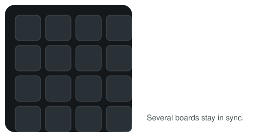

# TinkerPad — VoiceBoard

<p align="center"></p>

<p align="center"><a href="https://lonely-binary.github.io/TinkerPad/#voiceboard"><b>▶ Install from your browser</b></a> · no Arduino IDE needed</p>

A family voice message board. Twelve people, one key each. Messages are kept in
flash, so they survive a power cut.

```
[ 1  ][ 2  ][ 3  ][ 4  ]
[ 5  ][ 6  ][ 7  ][ 8  ]      one key per person, each in its own colour
[ 9  ][ 10 ][ 11 ][ 12 ]
[MIC][REPLAY][DELETE][ALL]
```

Everything is a **tap**. Only DELETE is held. Nothing has to be held down while you talk.

| Do this | What happens |
|---|---|
| **Tap MIC** | MIC breathes red, and the twelve person keys and ALL light up: "who is it for?" |
| **Tap the person's key** | A short beep, then recording starts. **Only that key** is lit, pulsing red with your voice |
| **Talk, then tap any key** | The message is sent |
| **Or just stop talking** | After 2.5 s of quiet it sends itself. If nothing is said within 8 s, it is cancelled |
| **Tap MIC, then ALL** | A message for everyone (an announcement) |
| **Tap a person's key** | Plays their oldest unheard message (announcements included). With nothing new, it **replays the last one they heard**, even though the key is dark |
| **Tap ALL** | Plays the latest announcement |
| **Tap REPLAY** | Plays the last message again |
| **Hold DELETE for 1 s** | Deletes the message that was just played. The key fills and turns red; let go to cancel |

Sent: two white blinks on the recipient's key and a rising chime. Two red blinks mean
"nothing here" or "not sent". Tap MIC and choose nobody, and it cancels after 10 s;
tapping MIC again cancels too.

**The lights.** When idle, **only MIC glows**, dimly. A person with unheard messages has
their key **lit** in their colour, with one pulse per message (up to five). A message
playing makes its key breathe.

## Several boards, kept in sync

Boards keep each other identical: new messages, who has heard what, and deletes reach
every board. **There is no pairing and nothing to press.** Boards that can hear each
other join automatically.

**Two ways to find each other** (chosen on the settings page)

| Mode | How boards find each other | Good for |
|---|---|---|
| **ESP-NOW** (default) | Radio broadcast, board to board | One house, no router needed |
| **Wi-Fi** | UDP broadcast on the local network | Boards on the same Wi-Fi |

The two modes **do not talk to each other**: a board on ESP-NOW cannot see one on Wi-Fi.

**Settings page**

- For 15 minutes after power-on the board runs a hotspot called `VoiceBoard-XXXX`, with
  no password. Join it from a phone and the settings page opens by itself, or browse to
  `http://192.168.4.1`.
- Pick the mode. For Wi-Fi, choose the network from the list, type the password, then
  save. The board restarts.
- In Wi-Fi mode the hotspot stays open until the board connects, so a wrong password
  can always be fixed.

**Status LED** (the single RGB LED on the ESP32-S3 board, IO48)

| Colour | Meaning |
|---|---|
| Blue, slow blink | The settings hotspot is open |
| Yellow, fast blink | Wi-Fi mode, not connected yet |
| Green | Wi-Fi connected |
| Cyan | ESP-NOW mode |

Dim: no other board nearby. Bright: syncing with at least one other board.

**How syncing works**

- Every two seconds each board broadcasts "I am here" together with a fingerprint of its
  messages. When two fingerprints differ, the boards catch each other up.
- A 20-second message is about 150 KB and takes about 3.3 s over ESP-NOW. A message of a
  few seconds takes well under a second.
- A board that was switched off or out of range catches up when it comes back.

**This is an example, deliberately open.** The settings hotspot has no password, any
board running this firmware joins the sync, and nothing is encrypted. Add pairing and
encryption before using it anywhere that matters.

## Limits

- A message is at most **20 s** long. Anything under 0.4 s counts as an accidental tap
  and is not sent.
- Storage: 4-bit IMA ADPCM at 14.7 kHz, about 7.4 KB/s, so the 9.9 MB partition holds
  roughly **20 minutes**. When it is full, the oldest heard messages go first, then the
  oldest unheard ones.
- **No privacy:** the board cannot tell who is pressing a key, so anyone can play anyone's
  messages. That is also why DELETE has to be held.
- There is no clock, so messages carry no time.
- An announcement counts as heard once anyone has heard it, and can then be cleared to
  make room.

## Build and upload

Arduino IDE settings (Tools menu):

| Setting | Value |
|---|---|
| Board | ESP32S3 Dev Module |
| Flash Size | 16MB (128Mb) |
| PSRAM | OPI PSRAM |
| Partition Scheme | 16M Flash (3MB APP/9.9MB FATFS) |
| USB CDC On Boot | **Disabled** on the UART port, **Enabled** on the USB port |

The partition scheme matters: without the FAT partition there is nowhere to keep
messages. Library needed: **FastLED**.

With `arduino-cli`:

```bash
arduino-cli compile --fqbn "esp32:esp32:esp32s3:PSRAM=opi,CDCOnBoot=default,FlashSize=16M,PartitionScheme=app3M_fat9M_16MB" VoiceBoard
```

Use `CDCOnBoot=cdc` instead when uploading through the native USB port.

## Key numbering

There is nothing to calibrate. Key number, LED number and position are the same: row by
row, left to right, 0 top-left to 15 bottom-right. The LED under key *n* is LED *n*. See
`layout.h`.

## Serial console (115200 baud)

| Key | Does |
|---|---|
| `s` | Status |
| `l` | List messages |
| `e` | Codec self-test |
| `p` | Sync status |
| `w` | Network status |
| `a` | Close the settings hotspot now |
| `n` | Make a test message for person 1 |
| `h` | Person 1 hears their oldest message (for testing) |
| `d` | Delete the newest message (for testing) |
| `W` | Delete **all** messages |

## Files

| File | What it does |
|---|---|
| `VoiceBoard.ino` | Key gestures, recording and playback, the serial console |
| `store.*` | Message storage on FAT, the ADPCM codec, heard flags, delete records, import and export for syncing |
| `sync.*` | Finding other boards, state fingerprints, catch-up sessions; over ESP-NOW or UDP |
| `portal.*` | The settings hotspot and web page, the Wi-Fi connection |
| `ledui.*` | The twelve person colours, unread pulses, the status LED |
| `layout.*` | Key, LED and position numbering, and which key does what |
| `mic.*` `mixer.*` `pads.*` | Microphone capture, audio output, key scanning |
